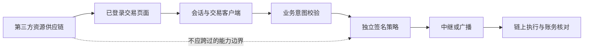
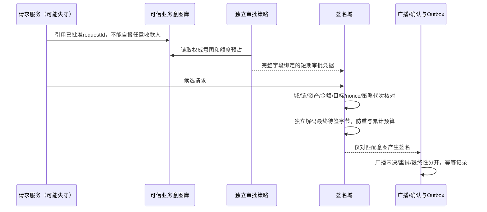
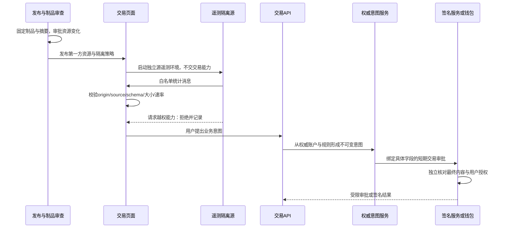
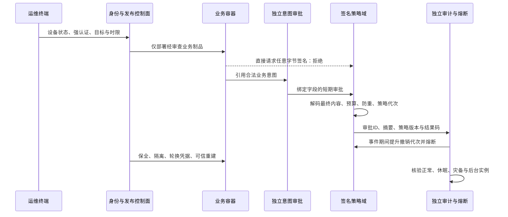
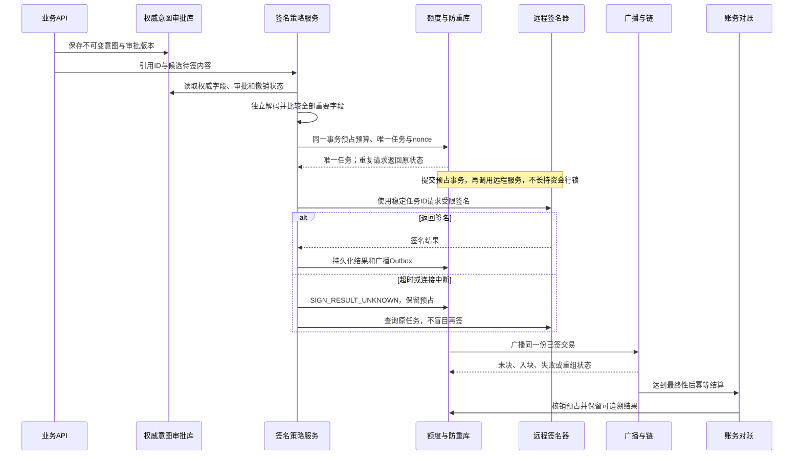
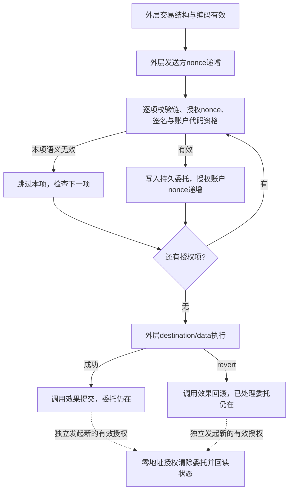
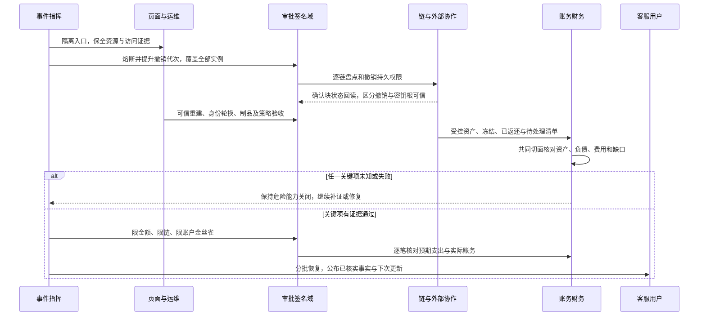

# 2026-10-30 安全事件：从业务损失到权限边界

资料截止：2026-10-30。阅读顺序：先看1—3节了解全盘，再看4—8节的机制、实施与验证。这里给出的是防御设计和本地实验，不是两家平台的最终取证报告，也不是投资建议。

## 1. 一句话讲清楚：钥匙没被拿走，柜台仍可能被冒用

平台把一种低风险能力交给外部参与方时，可能同时意外交出了高风险能力。监控脚本本应测页面，运维账号本应维护服务；如果它们可以触达交易会话、提现指令或签名器，攻击者不一定要把私钥导出，仍可能完成未授权操作。

这和“区块链密码学被破解”不是一回事。我们要分别问：谁控制页面？谁提出交易？谁批准业务意图？谁产生签名？谁广播？链上实际执行了什么？每一步的答案都可能是不同身份。

| 词语 | 非技术理解 | 不能混同的概念 |
|---|---|---|
| 登录会话 | 柜台认得你，允许你办某些事 | 登录成功不等于同意每笔交易 |
| 私钥 | 能产生有效签名的根权限 | 没发现导出不等于没人能冒用签名服务 |
| 签名服务/HSM/MPC | 保管钥匙并按请求盖章的设施 | 防钥匙被复制，不自动保证每份文件都该盖章 |
| 链上授权/委托 | 已登记的代办权限 | 关网页、换密码不一定能收回它 |
| 冻结资产 | 暂时不能继续流转的资产 | 不等于已退到平台可控账户 |
| 账本余额 | 对客户负债与交易事实的记录 | 不等于此刻平台拥有同额可动用资产 |

## 2. 两起事件分别是什么，哪些事实已经更新

### Polymarket：第三方入口越过了交易页面边界

官方状态页确认第三方服务商受损，进入只撤单、暂停中继的状态后恢复，并承诺补偿受影响用户。其记录覆盖北京时间10/30 02:05—03:05。[官方状态](https://status.polymarket.com/cmvtuswgi00221bkzps7w21pt)

Hudson Rock 的研究把异常行为定位到监控集成，并描述了复用页面交易客户端和签名能力的路径。注意：研究方观察到请求签名，不代表所有请求都被静默批准；收款地址余额也不是已核实的事件总损失。本模块没有下载或执行该脚本。[研究说明](https://www.infostealers.com/article/polymarket-breach-alert-wallet-draining-code-found-in-a-third-party-script/)

### Binance：官方初步入口与链上机制是两个层面

官方后续公告披露：疑似运维电脑受损后进入服务容器，产生未授权提现；当时未发现钱包私钥泄露证据。估算影响约63亿美元、约30亿美元被冻结，并说明承担损失。最终技术根因仍待调查。[官方公告](https://www.binance.com/en/support/announcement/detail/c5a8729a97ac486d963784d96c5642d7)

我们还核对了公告的公开CMS正文：末尾修订备注澄清**入金正常，暂停提现**。有些早期搜索摘要仍写充提都停，不能将索引旧版本当当前状态。[官方正文读取路径](https://www.binance.com/bapi/composite/v1/public/cms/article/detail/query?articleCode=c5a8729a97ac486d963784d96c5642d7)

Crystal 对以太坊链路给出了7702委托与批量授权分析；它是研究机构的链上解释，不是完整官方复盘，本项目未独立重放交易。以太坊机制也不能直接解释其它链全部流出。[链上研究](https://crystalintelligence.com/investigations/binance-hack-what-we-know-what-teams-should-do-now/)

当前不能下结论：私钥一定被偷、特定攻击组织实施、两起事件来自同一组织、冻结金额就是已追回金额、总影响减冻结就是最终净损失。把这些猜测当定论，会误导修复优先级。

## 3. 从业务上看：不要只盯一个“被盗金额”

### 四本账和一套恢复条件

1. 客户负债：客户仍拥有哪些法律和产品约定的余额/持仓权益。
2. 我方控制资产：真实地址、合约和银行账户里能被合法调动的资产。
3. 冻结/追索资产：位置已知但未完成返还和控制权确认的资产。
4. 已追回/注资：真正回到我方控制、完成对账和审批的资产。

例子是合成数字：客户负债100单位，平台资产转出100单位，发行方冻结60单位。此时不能说“余额还剩60，可以恢复60的提现”。可用资产可能仍是0。追回20或另行注资，是另外的事实；需要追加相应记录，不能删除原转出或修改用户历史流水。

“账本借贷平衡”和“资产足以覆盖客户负债”要同时检查。损失和注资都可以被正确记账，但资产缺口、控制权和会计确认仍是独立问题。

### 停什么，要按能力拆开

建议把下单、撤单、中继、充值归集、充值记账、提现签名、广播、查询、客服分开开关。它们不应共用一个含糊的“系统维护”标志。

- 提现/签名出现风险：先阻断新的高风险授权，再判断链上已生效权限。
- 前端会话不可信：不能只因这是撤单就沿用旧会话放行。必要时独立通道或重新认证。
- 已成交业务：暂停新交易不能抹掉已有成交和资金义务，继续在隔离流程中清算、对账。
- 查询/客服：尽可能保持可信只读状态，明确哪些数据延迟、哪些动作暂停。

这不是要求每次事故全部停机，而是提前设计小粒度控制，使限制影响面与已知风险相匹配。

### 沟通不是最后补一句“用户安全”

对外更新采用固定模板：已知范围、已采取动作、用户当前能做什么、不要做什么、下一次更新时间、仍未知什么。金额标注时间和统计范围。客服、运营、安全与财务共用同一事实表，不各自引用社交媒体截图。

## 4. 技术链路一：第三方脚本为何能越权

这是防御分析图，不是两家真实内部架构。关键在于：普通外链script在宿主页运行，不会因为它来自监控公司就自动获得较低权限。`async`只影响加载时序，模块化、闭包、React状态和变量名也不是安全隔离。[OWASP第三方代码管理](https://cheatsheetseries.owasp.org/cheatsheets/Third_Party_Javascript_Management_Cheat_Sheet.html)

### 分清几种常见防御的边界

| 措施 | 能解决什么 | 仍不能解决什么 |
|---|---|---|
| HTTPS | 保护传输 | 供应商自己发布了恶意内容 |
| CSP域名白名单 | 拒绝不允许的资源来源 | 已允许域名上的内容改变；同页面内调用现有能力 |
| SRI固定摘要 | 内容变化时不执行该资源 | 首次批准就恶意、摘要和代码一起受损、实际CORS条件不满足 |
| HttpOnly Cookie | JS不能直接读取Cookie值 | 同源脚本仍可能借会话发请求 |
| Trusted Types | 降低特定DOM注入风险 | 已正常获得执行权的恶意脚本 |
| 独立源iframe/遥测服务 | 减少接触交易页和signer | bridge自己又暴露交易接口、origin/source校验错误 |

SRI应由独立的审查与发布流程固定，不可“每次拉CDN顺手更新摘要”。静态网站不能把固定字符串当每响应随机nonce；启用CSP前必须盘点框架的内联引导脚本、样式、动态加载和报表，先验证兼容再执行限制。[SRI说明](https://developer.mozilla.org/en-US/docs/Web/Security/Defenses/Subresource_Integrity)、[CSP说明](https://developer.mozilla.org/en-US/docs/Web/HTTP/Reference/Headers/Content-Security-Policy/script-src)

### FinCore推荐实施顺序

1. 交易/签名页面默认不引入第三方可执行监控，能用服务端指标就不加浏览器权限。
2. 盘点HTML静态引用、构建依赖、tag manager、动态加载和发布身份，分别记录维护人和摘要。
3. 必要脚本经过审查后自托管或固定版本；独立核验资源摘要和跨域条件，失配就阻断，不静默退回无校验加载。
4. 遥测只传白名单非敏感字段，独立源隔离；消息桥只允许统计事件，不能传任意函数名或signer引用。
5. 依然由服务端和签名域核验业务意图。不能把防线全压在同一页“确认”按钮上。

## 5. 技术链路二：EIP-7702到底改变了什么

7702允许EOA登记代码委托。它有`0x04`交易类型；授权签名前像以`0x05`区分域。授权元组包含链、目标代码地址、nonce及签名；协议先处理授权列表，不满足条件的条目跳过，生效项递增nonce。委托具有持久性，外层执行失败不自动清除它。[协议规范](https://eips.ethereum.org/EIPS/eip-7702)

工程上最重要的不是记住字段，而是识别**账户权限变化**：它不是一笔普通的零金额转账，不应按外层gas费、外层发起人或一次模拟的资产差额判断安全。

### 三个容易混淆的点

- 猜对nonce也不能凭空授权，仍须有效账户签名。本例50项仅表达无效跳过，不证明真实签名从哪里得到。
- 清除/替换委托与撤销ERC-20 allowance不是一类操作；断开网页也不是链上撤销。
- 若密钥已泄露，只清一次委托不足以恢复可信根；对方可能再次授权。要评估新密钥迁移、多链权限和未决交易，而非继续复用旧根权限。

不需要7702的托管钱包，默认拒绝未审批的委托及未知签名域。需要它的系统，应作为钱包权限变更办理：独立审查代码与可升级性、指定链、精确授权nonce、初始化和存储布局、事件监测、撤销方案、金丝雀额度和人工审批。`chain_id=0`的跨链语义必须显式拒绝或单独审批。

本模块不实现恶意委托合约、不签7702消息。`models.mjs`中的`signatureValid`是显式测试桩，不是加密验证；协议代码资格、gas和EVM执行均不在模型内。

## 6. 真正落地的签名防线：审批和最终字节必须一致

参考代码`SigningIntentGuard.java`真正运行Ed25519审批验签，绑定requestId、操作、链、钱包、资产、收款人、最小单位金额、调用数据摘要、nonce、有效期、策略版本和会话代次。长度前缀编码避免简单字符串拼接的歧义；数组防御性复制避免调用方改动审批。

生产必须补上的部分：

1. 不接受客户端声称“这是普通提现”的DTO代替原始交易解码。只允许服务端从权威意图构造消息，签名器对最终字节再独立核对。
2. 审批与签名不共用运维身份、网络或发布链。单进程示例是验证算法，不是独立信任域。
3. 请求防重、余额/额度预占、Outbox和签名状态持久化。签名完成、广播完成、链上最终确认是不同状态。
4. 超时后查原意图和交易标识，不直接签第二份；nonce分配、替换交易和失败退款有显式状态。
5. 单笔和跨实例滚动额度都要原子预占。示例中3个7500最小单位并发请求，累计上限20000，只允许2个成功。JVM锁不能代替跨实例资金事务。
6. 时间取可信服务端时钟；策略或会话撤销有单调代次，旧审批即使未到期也不能继续用。

## 7. 止血、修复与恢复的验收表

| 阶段 | 业务动作 | 技术证据 | 拒绝恢复的条件 |
|---|---|---|---|
| 止血 | 限制高风险能力，保持可信查询与公告 | 可疑入口、会话、工作负载和签名调用被隔离 | 无法确认谁仍能签名/调用 |
| 保全 | 建立统一事实口径 | 构建/脚本摘要、日志、消息、链上标识和时间线 | 关键证据被覆盖，只剩截图 |
| 权限清理 | 明确客户应做与不应做的动作 | 旧凭据不可用，各类链上权限分别核验 | 仅退出登录或重启容器 |
| 环境重建 | 可信控制面和责任人恢复 | 已验证镜像、身份、发布审批与网络边界 | 仍使用受损制品/运维身份 |
| 资产核对 | 明确负债、缺口、追索与补偿 | 共同切面的账本与链上控制权对账 | 冻结冒充到账，历史流水被改平 |
| 金丝雀 | 小额、单链、限定客户逐步恢复 | 限额/熔断/告警/幂等和回退演练 | 撤销、核对、观察任何关键项未知 |

保全资料不等于把敏感日志公开。对外材料用脱敏时间线和可核验摘要；原始凭据、访问令牌、身份信息和司法协作细节留在受控系统。

## 8. 怎样证明“修好了”，而不是只换了版本

本地可验证项：第三方静态引用盘点、固定内容摘要比较、授权列表语义、审批绑定、真实加密验签、防重、过期、熔断、并发累计预算、冻结与恢复门禁。命令见实验目录README。

项目的静态导出脚本已经接入外链脚本门禁：当前本站不需要外部script，生产HTML出现此类引用就中止导出；即使声明SRI也不自动豁免。该门禁仅识别带引号的静态script引用，不扫描浏览器扩展、动态加载或全部资源依赖，不把“未发现外链”当安全认证。`node asset-audit.mjs /本地HTML文件`可单独查看盘点结果，过程不会请求或执行脚本。

仍需真实环境验收：浏览器CSP/SRI/CORS实际效果；旧标签页与动态资源清理；会话/工作负载轮换；签名器隔离；Ethereum实际交易解码与模拟；多链撤销；HSM/MPC策略；跨实例额度事务；外部冻结/返还确认；值班与对客补偿演练。

不能用单元测试通过证明真实平台已安全；也不能用一次`eth_call`没有损失证明持久授权没风险。对权限变更须检查状态差分和所有后续可调用能力，而不只是模拟一次外层调用。

## 9. 使用本项目新模块

- 概览和事实等级：非技术人员先看“发生了什么、四本账、现在还不知道什么”。
- 防御架构和两个机制：工程人员展开“低信任入口如何碰到高风险权限”。
- 八场景回放：切换有/无资源固定、隔离、有效授权和恢复条件，逐步查看判断。
- 真实测试证据：区分Node规则、Java加密/并发和浏览器待核验项，查看源码摘要与实际耗时。
- 完整手册与源码下载：可以离线编译验证，不要求钱包或模型账号，不影响公网资金或其它服务。

本手册的方案是FinCore的防御建议，不声称它就是Polymarket或Binance的内部实现。事实将来更新时保留旧结论和来源时点，不能悄悄把“初步调查”改成“最终原因”。

## 10. 浏览器链路：资源加载不等于授予交易能力

页面中普通script在宿主源的上下文执行。它是否能调用具体交易对象取决于应用暴露方式，不能假定任意脚本都能读取所有闭包；但闭包和框架状态也不应被当成可信隔离。HttpOnly可降低Cookie直接读取风险，无法单独阻止同页代码发起带会话的请求。交易服务必须独立核对业务权限和特定意图。

建议把遥测放入独立origin，只提供窄消息接口。接收方同时核对`event.origin`、`event.source`、消息schema、大小与速率；只允许明确的统计事件。不桥接任意URL、方法、HTML、签名器或交易对象。sandbox能力按实际需要收紧，不能为方便接入把同源权限放回去。

验收不只看CSP响应头存在。需要验证资源字节改变会失败、跨源访问被拒、伪造消息被拒、遥测看不到令牌与签名能力、仅登录态无法执行敏感交易。受损脚本移除后还需控制旧标签页、缓存与Service Worker，必要时提升会话代次。本站静态外链发行门禁已经实现，真实浏览器隔离联调尚待验收。[OWASP第三方代码管理](https://cheatsheetseries.owasp.org/cheatsheets/Third_Party_Javascript_Management_Cheat_Sheet.html)

## 11. 运维到签名：拆分身份、网络和发布控制

建议把业务容器、意图/审批服务和签名策略域分开：各有工作负载身份和发布权限，运维终端使用限目标、限时的临时授权。网络可达只是连接条件，mTLS证明调用者身份，交易审批决定具体业务是否允许。不得让业务身份读取密钥、修改签名策略或调用任意摘要签名接口。

HSM/MPC保护密钥材料，业务策略决定该签什么，两者各有职责。业务、审批、签名共用管理员或长期令牌会削弱隔离。只改一个实例的策略还可能留下旧实例旁路。建议拒绝未知交易类型和未知策略代次，按钱包/链/资产及更高层业务域设置累计预算，关注拆单与跨钱包聚合风险。上述身份与网络隔离是生产设计，本地Java同进程实现不能证明它们已成立。

## 12. 逐笔提现：事务、远程签名与未决任务

完整意图绑定requestId、操作、链、钱包、资产、收款人、最小单位金额、调用数据摘要、nonce、有效期、策略版本、会话代次。规范编码采用长度前缀与明确域标签，审批数组做防御性复制。页面中的真实代码片段直接提取自已编译的Java文件，并显示SHA-256。

生产签名服务必须独立解码待签字节：原生币核对to/value；代币交易还要核对合约、方法、实际收款人、数量与调用数据；费用预算和授权列表单独约束。外层to若是代币合约，并不等于实际收款人。仅比较客户端提供的“提现”标签或一张预览图不够。[OWASP交易授权](https://cheatsheetseries.owasp.org/cheatsheets/Transaction_Authorization_Cheat_Sheet.html)

| 状态 | 允许动作 | 不能自动做的事 |
|---|---|---|
| APPROVED | 核对后原子预占 | 未审批先签 |
| RESERVED | 用唯一任务请求签名 | 重试再次预占 |
| SIGN_RESULT_UNKNOWN | 查原签名任务与审计 | 超时就释放或另签一笔 |
| SIGNED | 用Outbox广播原交易 | 把签名成功当提现完成 |
| BROADCAST_UNKNOWN | 查询原交易标识及nonce | 换nonce生成第二笔支出 |
| INCLUDED | 等待最终性并处理重组 | 重复入账或提前终结 |
| FINALIZED | 幂等返回完成、核销预占 | 改写历史来掩盖差异 |

签名未决、广播未决、确定失败不是同一种状态。预占释放要有确定的取消/失败证据，不能仅因请求超时释放。生产需要数据库唯一键、条件更新、持久任务、Outbox和独立nonce分配器；签名服务须支持稳定任务ID下查询/去重。Java实验仅验证同实例锁下的审批与累计预算，不提供这套远程协议。真实交易替换和费用调整应单独审批并关联原业务，不把新签名误认为第二笔提现。

## 13. 7702：两个阶段与两种无效

“无效项跳过”是授权处理阶段的语义规则；结构/数值编码越界可能使整个交易无效，不能混为一谈。若发送方与授权账户相同，计算授权nonce时必须考虑发送方已递增。本地模型从授权处理时的nonce=49开始，不实现外层发送方递增。它也不实现RLP、secp256k1恢复、gas或账户代码资格。

外层发起人和授权账户可以不同，支付gas不意味着取得他人权限。链0、nonce上下界、同账户多项有效授权、最后有效项覆盖、零地址清除与持久性都要单独审查。规范中的有效授权nonce须小于2⁶⁴−1。仅模拟一次外层调用无法证明所有后续委托能力安全；委托代码的身份校验、初始化、存储布局及升级路径还要独立审计。[EIP-7702](https://eips.ethereum.org/EIPS/eip-7702)

## 14. 恢复协作：用证据连接技术和资金

旧凭据和代次撤销要验证在全部实例生效；旧密钥失守时还须重建密钥根。冻结资产不计可用资金，返还要核对实际控制权与最终性。金丝雀须贯穿审批、签名、广播、最终性、账务和告警，不能只测首页和HTTP成功。任一关键证据未知就保持关闭；补足资金和修好权限分别验收。应急动作、负责人、证据与放量决定要可追溯。

页面新增四张详细时序图和一张授权状态图，连同原有概览共七张。每条链路均附机制、失效方式、验收证据与落地范围。图中流程属于生产目标的部分已明确标注，不宣称远程签名、数据库或真实链恢复在本实验完成。
