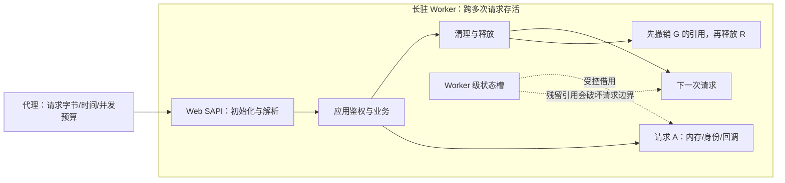
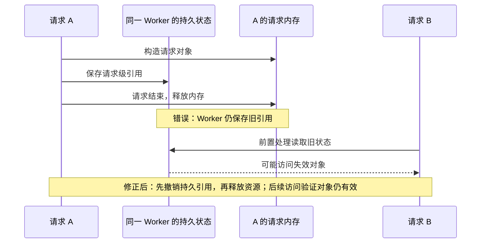

# PHP 运行时漏洞：从补丁到请求隔离

资料核对日期：2026-10-29。本文覆盖已核对的当月官方公告，不推断未来版本，也不代表项目服务器已经部署或修复 PHP。本项目主业务使用 Java；安全实验包含可执行的 Java、Node.js、Python 和 C++ 对照。

阅读顺序：一至四节保留概览；五节拆解机制与图；六节对照代码及实测；七节给出实施责任与验收矩阵；八节提供完整复核步骤。页面对应入口为“逐案拆解”“实测对照”和“修复交接演练”。

## 概览：先处理哪几件事

1. 找到实际承接 Web 流量的 PHP、镜像、扩展、长驻进程及负责人；CLI 版本不能代替 Web Worker 版本。
2. 修复两项核心 RCE：上游基线为 8.2.35 / 8.3.36 / 8.4.27 / 8.5.12。发行版回补必须核对供应商公告与完整包修订号。
3. 同时处理 10 月 23 日会话配置补充，以及 10 月 26 日 Windows Brotli 重打包。
4. 替换全部旧进程，在真实 SAPI 上验收；保留包摘要、配置、Worker 代际与回归结果。仅下载或安装软件不算完成。

官方入口：[PHP 2026 年公告](https://www.php.net/archive/2026.php)。下面分开记录漏洞事实、工程推论和本项目实验。

## 一、问题在哪里

| 公告 | 问题与边界 | 修复要点 |
| --- | --- | --- |
| CVE-2026-109618，10/21 | 内存分配失败打断了不具备完整失败保护的初始化过程，清理阶段可能读取无效状态。属于运行时问题。 | 更换带补丁的 PHP；官方实现将相关 OOM 处理移到 VM 安全点，并在更高阈值下直接终止进程。 |
| CVE-2026-109619，10/21 | Worker 保存的全局引用可能超出请求内存生命周期，后续请求在初始化前使用残留状态。 | 运行时升级是根本措施；关闭上传进度只能挡住部分已确认路径。 |
| CVE-2026-115560，10/23 补充 | 需要上传进度开启，并有特定的序列化器运行时切换：从 php_binary / php_serialize 切到 php 后启动会话。不能泛化为所有上传应用。 | 官方建议暂时设置 session.upload_progress.enabled=0，持续关注后续正式补丁。不能宣称 10/21 版本已经覆盖该补充问题。 |
| CVE-2026-111497，10/26 Windows 更新 | Brotli 解压的越界写风险，经启用自动响应解压的 cURL 路径可达。应用使用的本地依赖也需要纳入清单。 | 官方 Windows 包更新到 8.2.35-1 / 8.3.36-1 / 8.4.27-1 / 8.5.12-1，包含 Brotli 1.2.1；PHP 核心版本不随包修订变化。 |

核心技术依据：[OOM 公告](https://github.com/php/php-src/security/advisories/GHSA-w8hw-w9fx-j79w)、[残留状态公告](https://github.com/php/php-src/security/advisories/GHSA-6wmf-4rv5-p3rp)。后两项见 [10/23 与 10/26 官方更新](https://www.php.net/archive/2026.php)。这些是各自公告的处理范围，不是一条泛化的“PHP 不安全”结论。

### 为什么改业务参数校验不够

处理顺序是：代理接收请求 → Web SAPI / 运行时初始化与请求解析 → 应用入口与鉴权 → 业务逻辑 → 请求清理 → Worker 复用。部分问题发生在应用入口之前。业务代码即使正确拒绝参数，也不能给已经发生的运行时内存损坏打补丁。[PHP 手册明确说明上传进度状态可以在脚本执行前写入会话](https://www.php.net/manual/en/session.upload-progress.php)。

这是两个应独立检查的工程约束：未初始化成功的对象不要向外发布；请求结束前撤销所有 Worker 级引用。普通业务异常可以经过 finally；非局部跳转、进程终止及底层分配失败不能假定具有同样的清理保证。

## 二、如何修改和规避

### 资产盘点与版本升级

- 记录入口、SAPI、操作系统、安装来源、完整软件包修订、镜像 digest、实际加载扩展与共享库、进程启动时间、负责人；覆盖 Web、队列、定时任务和后台导入服务。
- 上游原版按对应维护分支比较补丁号，不把版本当作浮点数。供应商包按其安全公告确认回补，不单凭 php -v 的前三段判断。
- 8.1 及更早版本已无 PHP 上游常规维护。优先迁移受支持版本；特殊回补包必须有维护者、验证记录和迁移截止时间。不能把临时源码回补当作长期支持计划。
- Windows 记录发行包修订与摘要；8.5.12 和 8.5.12-1 的核心版本输出可能相同。Linux 或其他语言若加载同一 Brotli 库，也要检查依赖来源，不能只检查 Windows。

版本与来源均需绑定到实际 Worker。CLI 的 ini 路径与扩展只能作为旁证，禁止以本机 CLI 成功代替整个集群验收。

### 启动配置示例

以下是 FPM pool 中的示例，需要结合业务上传大小和安装路径审查后使用。不要在应用 PHP 脚本或 .user.ini 中临时补这些前置设置。

```ini
; 示例：在请求解析前生效。替换全部 Worker 后核对。
php_admin_flag[session.upload_progress.enabled] = off
; 仅 PHP 8.5：收窄官方确认的一条 fatal backtrace 路径。
php_admin_flag[fatal_error_backtraces] = off
; 上传业务示例，大小根据真实需求与内存预算确定。
php_admin_value[post_max_size] = 32M
php_admin_value[upload_max_filesize] = 24M
```

这组配置缩小部分入口，不能取代核心升级。停用上传进度可能影响前端进度条，需要同步改为网关/客户端进度或暂时隐藏该功能。

```nginx
# 示例：实际 server/location 中的入口预算，不能替代运行时补丁。
client_max_body_size 32m;
client_body_timeout 15s;
```

还要验证：无 Content-Length、分块传输、解压后体积、字段数、multipart 部件数、嵌套与慢速发送。Nginx 上面两条指令并未实现所有这些约束；应按代理能力增加限制或暂时关闭相应入口。畸形解析用例只在隔离测试环境执行。

### 特别容易做错：把内存上限一关了之

官方列出的应急措施包含 memory_limit=-1，以减少可控 PHP 内存上限触发路径，但底层分配失败风险仍然存在。这不是本项目默认配置。全局关闭上限会扩大资源耗尽风险；若确实采用，必须有容器/cgroup 硬预算、并发预算和经过演练的退出策略。官方不建议用 RLIMIT_AS / RLIMIT_DATA 替代，因为它们可重新制造分配失败路径。具体取舍由应急负责人记录，升级仍为首要任务。

容量预算要同时考虑 Worker 数量、每个 Worker 峰值 RSS、Web 代理缓冲和宿主机预留。CPU 高低不能单独判断安全；监控内存与 Worker 异常退出比只看 QPS 更有价值。

### 发布、观察与回退

1. 先在隔离副本运行正常上传、导入、会话、异常回调、超时与进程替换用例，记录预期响应、错误率和请求间状态隔离结果。
2. 在有冗余的实例上先切一部分流量，确认实际 SAPI、配置和依赖，再逐个摘流与替换旧 Worker。单实例需安排短暂维护窗口，不能承诺无中断。
3. 按新旧代际观察 5xx、崩溃/重启、RSS/cgroup OOM、请求与上传字节、解析失败、P95/P99、队列积压及异常出站；生产日志不记录上传内容、Cookie 或密钥。
4. 旧镜像若含已知漏洞，不作为开放公网的直接回退目标。保留一份已修补的上一稳定制品；没有安全回退制品时关闭受影响入口或进入维护状态。
5. 若怀疑已被利用，补丁不能替代事件调查。保留日志与镜像证据、隔离疑似实例，按接触范围轮换凭证并从可信制品重建。

这些步骤是实施方案，不代表本项目已经完成 PHP 集群演练或实测性能收益。

## 三、其他语言是否有类似问题

以下是同类机制对照，不表示它们受到上述 PHP CVE 影响，也不表示内存泄漏必然能变成 RCE。

| 语言 | 同类风险与区别 | 应对与验收 |
| --- | --- | --- |
| Java | ThreadLocal、MDC、线程池复用可使身份/租户/追踪上下文越界；GC 无法修复业务身份串用。JNI、本地压缩库仍属于原生风险面。 | 同步请求在 finally 移除上下文；显式传播异步身份，禁止匿名任务继承旧身份。JVM 严重内存故障按进程级策略处理，不 catch 后返回成功。 |
| C / C++ | 释放后使用、半初始化对象公开、回调保存悬挂指针。C++ RAII 有助于正常作用域与异常清理，但不能给任意 longjmp 跨栈提供相同保证。 | 先完成构造再公开所有权；RAII/智能指针与清晰销毁次序；ASan/UBSan 与解析器 fuzz，限制进程权限。 |
| Python | 纯 Python 引用管理不等于 CPython、C 扩展和借用引用始终安全；异步请求状态也可能逻辑串用。 | 核对引用所有权与扩展版本；ContextVar token 在 finally reset；并发修改时遵守 C API 的锁与强引用要求。 |
| Node.js | JavaScript 自动内存管理不能覆盖原生 addon、V8 与本地解压依赖。全局可变请求对象还会引起逻辑串用。 | 使用请求范围对象，按需用 AsyncLocalStorage；核对 Worker 清理钩子与 addon 生命周期，并限制解压输出。 |
| Go | 普通 Go 与 cgo/unsafe 的保证不同；可复用对象或 sync.Pool 中残留身份属于业务生命周期问题。 | 明确 C 分配/释放责任，复用前后重置对象；上下文显式传参，原生库单独测试。 |
| Rust | 安全 Rust 的所有权减少这类内存错误；unsafe、FFI 回调和 C 库不自动继承全部保证。 | 为 FFI 指针、异步回调和注销次序建立明确契约，尽量安全封装，并对原生边界做 Sanitizer/fuzz。 |

依据：[Java](https://docs.oracle.com/en/java/javase/21/docs/api/java.base/java/lang/ThreadLocal.html)、[Python C API](https://docs.python.org/3/c-api/intro.html#reference-counts)、[Node addon](https://nodejs.org/api/addons.html)、[Go FAQ](https://go.dev/doc/faq#IsGoTypeSafe)、[Rust FFI](https://doc.rust-lang.org/nomicon/ffi.html)。表中的具体治理办法是本项目工程建议。

### Java 例子为什么与交易系统有关

线程池中的一个请求写入 tenant-A 后失败，如果没有解除绑定，后续匿名请求可能误用 A 的身份查询账户。这个缺陷不需要 PHP，也不需要大流量才能出现。高并发和线程复用让它更难排查。

源码 `ThreadLocalIsolationDemo.java` 用单线程池保证两个任务落在同一线程：先确认旧实现会泄漏，再确认修正后失败与成功路径都清理，且 tenant-B 能获得自己的上下文。示例只覆盖同步范围；异步链路必须传递明确身份，并在实际执行线程建立、释放其作用域。

## 四、本项目代码与验证

源码目录：`experiments/runtime-security/`。站点下载目录：`/runtime-security/`。

```sh
node --test experiments/runtime-security/php-policy.test.mjs
node experiments/runtime-security/assess.mjs experiments/runtime-security/inventory.example.json
# 示例含待处理项，第二条命令预期退出 2；不是测试失败。
```

`assess.mjs` 仅读取本地 JSON。退出 0 表示提供的清单满足这份日期固定的规则；2 表示仍有待处理/待核验；64 表示输入错误。记录为关闭或已替换属于输入声明，工具不会证明它在线上真实生效。下载包解压后在其根目录运行时，去掉命令中的 `experiments/runtime-security/` 前缀。

```sh
mkdir -p /tmp/fincore-runtime-security-classes
javac -encoding UTF-8 -d /tmp/fincore-runtime-security-classes experiments/runtime-security/ThreadLocalIsolationDemo.java
java -cp /tmp/fincore-runtime-security-classes ThreadLocalIsolationDemo
```

页面共用 `php-policy.mjs` 的离线规则和确定性生命周期模型。模型用受控异常表示初始化失败，不分配大量内存、不访问远端、不构造攻击请求。模型通过不等于 PHP 原生补丁验证；实际补丁仍需使用维护方的回归测试与隔离环境。

验收资料至少包括：资产清单、公告/回补依据、制品摘要、真实 Worker 版本与启动配置、新旧代际切换、正常/异常业务回归、回退方案和负责人确认。测试只验证本项目工具与示例，不发布生产安全认证。

## 五、深入拆解：资源、对象与请求是三条不同的边界

### 5.1 整体处理拓扑



代理约束到达的请求；运行时维护内部对象；应用维护身份与业务权限。只给业务 Controller 加参数校验，无法包住在 Controller 之前发生的解析，也无法替代原生库补丁。

对象至少区分五个阶段：未构造 → 构造完成 → 已发布 → 外部引用解除 → 已释放。“指针不为空”或“变量能 get 到值”都不能证明它仍可安全使用。正确性要求同时覆盖正常返回、初始化失败、异常清理和 Worker 再次使用。

### 5.2 OOM：为什么不能只说“加 try/catch”

普通函数失败通常沿预期调用栈返回。非局部退出会跳过中间层的正常收尾，代码审查时不能把两者混为一谈。一个对象若在初始化完成前进入全局状态，哪怕失败发生在别的分配点，也可能把它留给清理路径。

```text
错误机制示意（不是 PHP 原始源码）：
allocate → publish → initialize → allocation failure → non-local exit
                     尚未完成                         ↓
                                cleanup 仍假设“对象完整”

应用层约束：construct completely → publish → detach → destroy
PHP 核心补丁：调整 OOM 控制流，在安全点处理软 OOM；更高阈值下硬退出。
```

PHP 官方补丁有引擎级的安全点和硬终止策略，本项目的构造/发布模型只验证一个可迁移的约束，不能模拟完整 VM。C++ 普通异常中的 RAII、Java/Python 的 finally，也不能被推广为“任意严重运行时故障都一定能安全清理”。

资源输入还存在放大：网络字节数不等于解析对象占用的内存，压缩大小也不等于展开大小。除了请求体字节，还要审查字段、部件、头部、嵌套和解码预算；不能用一个 Content-Length 判断覆盖所有内存路径。

依据：[PHP OOM 技术公告](https://github.com/php/php-src/security/advisories/GHSA-w8hw-w9fx-j79w)。上述构造顺序是工程解释，不是可直接替换 Zend 实现的补丁。

### 5.3 残留状态：为什么单个请求成功也不算测完



审查时分别找“生产者”和“消费者”：谁把请求状态存到更长寿的位置，谁又会在后续请求读取它？只在下一请求的业务入口重置，可能晚于前置消费者。因此验证至少使用两个请求，并固定或确认它们复用了同一 Worker。

Java 示例用单线程池固定复用，Node/Python 用两个闸门安排交错，C++ 用 ASan 检测释放后的实际访问；这三种实验回答的问题不同。Java 的逻辑身份泄漏不能直接推出原生 RCE，ASan 报错也不是完整攻击可利用性证明。

依据：[PHP 残留状态技术公告](https://github.com/php/php-src/security/advisories/GHSA-6wmf-4rv5-p3rp)。

### 5.4 会话补充问题：为什么配置时机就是代码语义

以官方给出的特殊条件为例，启动配置与运行中切换的处理器不一致，前置状态和后续消费者可能不同步。处理时分三步：搜索业务代码中的序列化器切换；把所需处理器固定到启动配置；临时关闭上传进度并替换 Worker。保持登录和会话持久化不退化同样是验收条件。

```ini
; 示例：由业务选择一种一致的处理方式，先在隔离环境验证
session.serialize_handler = php
session.upload_progress.enabled = 0
```

不要把上面的处理方式机械替换到所有应用。已有会话数据使用不同序列化格式时，需要评估存量会话兼容、失效范围与重新登录策略。官方建议和完整触发前提见 [10 月公告](https://www.php.net/archive/2026.php)。

### 5.5 解码漏洞与解压放大：为什么必须拆成两项验收

原生解码器越界写属于内存安全问题，必须更新实际加载库。压缩数据展开后超出资源预算属于可用性问题，需要独立限制输入、输出和并发。后者的检查通常在解码器已经处理部分输入之后运行，无法倒过来修复前者。

本项目对资源问题使用 gzip，而非构造 Brotli 利用输入：固定 128 KiB 字节生成测试数据，检查展开量和拒绝行为。对具体 PHP Windows 包，仍按 [官方重打包公告](https://www.php.net/archive/2026.php)核对。HTTP 客户端请求 identity 并不等于证明本地自动解码已停用；必须核对实际客户端行为，并明确处理仍带编码头的响应。

## 六、代码与实测：负例先失败，修正后再通过

### 6.1 实验清单

| 实验 | 输入与安排 | 负例结果 | 修正和断言 |
| --- | --- | --- | --- |
| Java | 同一线程池 Worker 先执行 A 的失败任务，再执行下一任务 | 未 remove 时下一任务读到 A | 成功与失败都清理，B 可绑定，异常继续上抛 |
| C++ | 释放请求所有者后，从 Worker 裸指针读取 | ASan 检出 heap-use-after-free | 构造失败不发布，存活时弱引用可提升，结束后拒绝提升 |
| Python | 两协程确定性交错 | 共享变量观察 B/B | ContextVar 观察 A/B；异常恢复外层值 |
| Node.js | 两异步链确定性交错 | 全局变量观察 B/B | AsyncLocalStorage 观察 A/B；嵌套与异常隔离 |
| gzip | 压缩后的 128 KiB 重复字节 | 无输出预算时全部展开 | 32 KiB 上限返回 OUTPUT_LIMIT；不交付部分成功 |
| 交接记录 | 两个预期 Web Worker | CLI 替代、旧代际或缺失 Worker 时拒绝 | 摘要、范围、前置配置、补丁与回退记录一致才通过 |

2026-10-29 本机执行数据：压缩输入 **163 B**，无输出预算展开 **131072 B**；设置 **32768 B** 上限后返回 `OUTPUT_LIMIT`。这是功能实验，不是吞吐、内存峰值或生产容量测量。机器相关状态、退出码与源码摘要以 `evidence.json` 为准。

### 6.2 Java：同步范围正确，不代表异步任务自动继承正确

`ThreadLocalIsolationDemo.java` 的关键点是把 remove 放进 finally，而非普通尾部代码。它还验证业务异常未被吞掉。调用传入的 tenant 应来自已验证的身份信息，示例不执行认证。

异步派发时，要把可信的不可变身份显式交给任务，在执行任务的线程建立并释放作用域。线程池、虚拟线程、线程数增多不会自动修复错误的身份来源。取消后仍运行的子任务还需要超时、授权存活期与资源释放策略。

### 6.3 C++：弱引用改变的是所有权语义

错误代码从 unique_ptr 取得裸指针，再释放所有者，随后读裸指针。ASan 在独立子进程中报告错误，验证器要求明确的 heap-use-after-free 分类；仅“程序非零退出”不算负例检测成功。

修正示例在 make_shared 完成构造后才向 weak_ptr 发布；消费时先 lock，临时 shared_ptr 保证消费期间资源存活。过期后 lock 失败，不能继续读旧内存。源码 `request_lifetime.cpp` 只演示单线程所有权，跨线程修改状态槽还需要互斥或合适的原子发布机制。弱引用不是线程同步替代品。

### 6.4 Python 与 Node：异步链的上下文不同于线程全局变量

Python 的 ContextVar 保存 set 返回的 token，finally 中 reset 回进入前的值，支持正常嵌套。Node 使用 AsyncLocalStorage.run 为回调及其异步后续建立作用域。两个实验都用闸门确定交错顺序，不依赖随机 sleep。

特别注意：已经创建的子协程或异步后续可能保留创建时的上下文，不能把父作用域返回等同于“所有后台任务的身份都被撤销”。跨线程、worker_threads、跨进程与脱离请求存活期的后台工作，需要另设传播协议和取消/授权策略。本轮测试未覆盖这些跨边界场景。

依据：[Python contextvars](https://docs.python.org/3/library/contextvars.html)、[Node 异步上下文](https://nodejs.org/api/async_context.html)。

### 6.5 输入、输出、并发三个预算必须同时考虑

`decodeGzipBounded` 按实际接收的输入字节计数，不依赖请求声明。每个输出块也计数，超限时通过 pipeline 传播失败并停止，不向调用方返回部分结果；截断流、取消和非法预算同样拒绝。`DecoderPool` 的名额在 finally 归还，满额立即返回 BUSY。

这并非严格的堆内存上限：zlib 内部状态、输入流缓冲、输出块、暂存列表和 Buffer.concat 合并副本都会占内存。实施时应估计“每次解压峰值 × 同时解压数 + 固定开销”，并用目标环境实测确认。多进程还需入口总预算；本例的进程内计数器不能当作分布式限流。

完整保护还需要已修补的原生库、业务超时/取消、输出用途校验与容器资源边界。资源限制通过不等于解码器内存安全已经通过。

### 6.6 Go / Rust 的进一步核查点

Go：身份经 context 显式传参；sync.Pool 对象在复用前后清理，但必须等所有消费者完成才能归还，不能一边被 goroutine 使用一边放回池。cgo 的分配与释放责任另外建立契约。

Rust：安全所有权不能自动覆盖 C 库；关注 FFI 回调在请求结束后是否仍可能触发、注销与释放的先后关系，以及 unsafe 封装的生命周期承诺。弱引用/Arc 的选择取决于是否允许回调延长资源存活期。本轮未编译 Go/Rust 示例，因此这里只列核查与实施方向。

## 七、实施交接：每一步留下什么结果

### 7.1 逐阶段责任与产出

| 阶段 | 主要责任 | 实际动作 | 结束条件 / 失败时的动作 |
| --- | --- | --- | --- |
| 资产定位 | 服务负责人 + 运维 | 把域名/入口映射到 SAPI、镜像、扩展和 Worker；补齐漏管定时任务 | 无负责人或未知安装来源继续标待核验，不用 CLI 版本替代 |
| 补丁选择 | 运行时维护者 | 核对上游与供应商回补、Windows 包修订、本地解码库 | 公告、包修订与摘要可对应；无法对应则不宣称完成 |
| 业务兼容 | 开发 + 产品/运营 | 验证上传进度、会话、导入、超时与错误提示 | 不出现假成功；需要重新登录或停功能时有沟通方案 |
| 隔离验证 | 测试 + 开发 | 执行下面的功能矩阵，记录真实 SAPI 配置 | 失败项保留，不能删用例换取通过 |
| 发布替换 | 运维 + 值班负责人 | 摘流、替换、核对目标代际与所有 Worker | 发现旧代际或范围缺口就继续处理；单实例走维护窗口 |
| 观察与归档 | 服务负责人 + 安全 | 按代际观察错误、崩溃、RSS、OOM、P99、队列并归档 | 观察窗口和阈值采用本服务基线；不虚构固定的通用达标数 |

应用依赖清单也不等于运行时清单。Composer 不替代 PHP 引擎和系统库盘点；Node/Python 包管理器也未必识别镜像内手工安装的本地库。应保存制品摘要及依赖来源，而不是只记录“更新到最新版”。

### 7.2 目标环境验收矩阵

| 场景 | 需要观察的事实 | 预期行为 | 本项目证据等级 |
| --- | --- | --- | --- |
| 正常登录与会话延续 | 会话协议、登录状态、重新认证范围 | 满足业务兼容决定 | 方案，需真实 PHP 应用验证 |
| 正常文件上传 | 实际 Web SAPI、上传大小、进度反馈 | 合法请求可完成，停进度不伪造完成 | 方案 |
| 无可用 Content-Length 的请求 | 实际接收字节与前置拦截 | 限制不依赖头部声明 | Node 流计量有本地测试；代理/PHP 需另验 |
| 部件/字段/头部/嵌套过量 | 解析器预算、错误分类、Worker 状态 | 在各自边界拒绝，不无界占用 | 方案，需目标解析器隔离测试 |
| 解压输出超预算 | 输入与输出分别计量 | 明确失败，不返回部分成功 | Node 本地已执行 |
| 截断压缩流 / 取消 | 错误传播与名额归还 | 任务失败，后续请求仍可进入 | Node 本地已执行 |
| 请求 A 失败后复用 Worker | 同线程/同进程身份与引用 | B 不继承 A 的私有状态 | Java、C++ 本地已执行 |
| A/B 并发交错 | 每条异步链的身份 | 各自读取正确上下文 | Node/Python 本地已执行 |
| 核心包正确但旧 Worker 未替换 | 全部预期实例与观测代际 | 拒绝结束交接 | 记录规则本地已执行；现网需实证 |
| 回退镜像包含漏洞 | 回退制品修订与摘要 | 阻止直接开放旧镜像 | 记录规则本地已执行 |
| PHP 原生 OOM 与 UAF 回归 | 引擎补丁、隔离进程结果 | 满足维护方回归要求 | 本轮未执行 |

### 7.3 发布记录与权限边界

`release-gates.mjs` 核对预期 Worker 范围、观测来源、目标代际、制品摘要、前置配置与补丁/回退声明。缺失或冲突即拒绝；范围外实例也要求重新核对。本模块不采集或修改生产进程。

输入记录真实性、供应商签名、完整资产发现仍由受信系统和责任人确认。满足记录规则与“线上主机不存在漏洞”是不同结论。若怀疑已入侵，按照事件响应流程保全证据与重建，不能只做版本更新后清空告警。

## 八、复核代码和结果

源码与下载包包含相同的实验文件。解压下载包后：

```sh
node --test php-policy.test.mjs runtime-guards.test.mjs release-gates.test.mjs
node assess.mjs inventory.example.json
# 上一行含待办，预期退出 2
node verify.mjs
```

完整验证依赖已有 Node.js 22.13+、Java 编译器/运行时、Python 3.7+ 及支持 AddressSanitizer 的 clang++。验证器不安装软件。可通过 RUNTIME_SECURITY_PYTHON 或 RUNTIME_SECURITY_CXX 指定本机工具。C++ 错误分支在独立子进程运行，要求非零退出并明确匹配 ASan 错误类别，修正分支要求退出 0。

依据：[AddressSanitizer 官方文档](https://clang.llvm.org/docs/AddressSanitizer.html)。编译产物位于独立临时目录，验证器结束时回收；不会把二进制或本机地址写进公开下载包。`evidence.json` 保存实际结果、时间与源文件摘要。页面引用同一文件展示，避免手填成绩与代码漂移。
